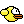
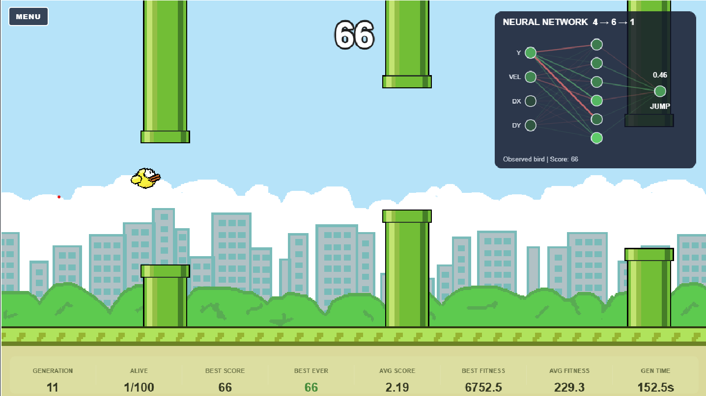
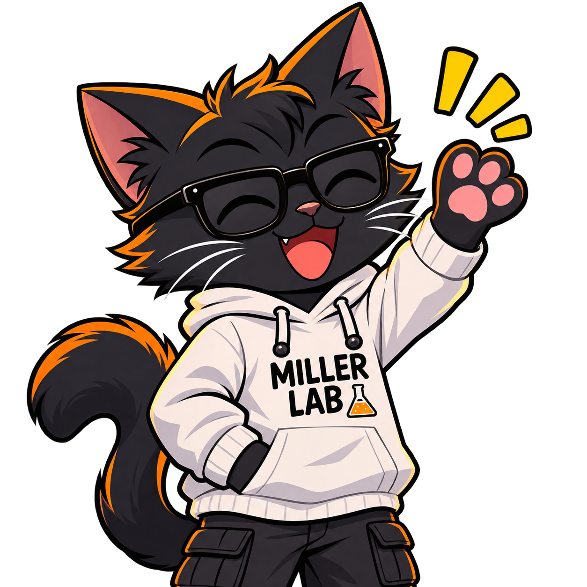

#  Flappy AI — Experiment #001

**Miller Lab — One Experiment at a Time**

Can 100 tiny neural networks learn to play Flappy Bird through evolution?

In this experiment, I recreated a Flappy Bird-style game using JavaScript and HTML Canvas, then trained a population of 100 birds using a genetic algorithm.

## 🧠 How it works

Each bird has its own neural network:

- **4 inputs:** bird height, vertical velocity, distance to the next pipe, and vertical difference from the gap center
- **6 hidden neurons**
- **1 output:** jump or wait

The birds learn through an evolutionary process:

1. Start with randomly initialized neural networks.
2. Let the birds play.
3. Evaluate their performance.
4. Select the best-performing networks.
5. Create new networks through inheritance and mutation.
6. Repeat for multiple generations.

No backpropagation or external machine-learning framework is required.

## 🎮 Run locally

Clone or download the repository.

From the project directory, start a local web server:
python -m http.server 8000

Then open:
http://localhost:8000

  

## 🎬 Watch the experiment

YouTube: https://www.youtube.com/watch?v=ONKEq9kWku4

🐈 About Miller Lab

  

Miller Lab is a creative laboratory where I build games, experiment with artificial intelligence, explore programming, and try to turn unusual ideas into working projects.

Sometimes things work.

Sometimes they fail spectacularly.

Either way, there's always something to learn.

Build. Experiment. Learn. Repeat.

📄 License

See the repository's LICENSE file for code licensing information. Graphics, sounds, and other assets may be subject to separate terms.

**One Experiment at a Time.**
